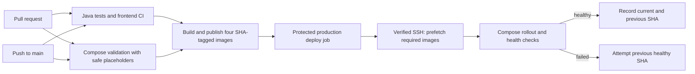

# Smart Agri CI/CD to a Linux VPS

The existing CI workflow validates pull requests and publishes only the four
application images used by the minimal production Compose stack. A successful
push to `main` can then deploy that exact commit to a VPS through a protected
GitHub Actions environment.



## What runs

- Pull requests run the existing Java verification matrix, frontend checks, and
  Playwright E2E job, plus production Compose syntax/required-variable checks
  and Docker builds for the four selected services. The PR image check does not
  log in to GHCR or publish images. PRs receive no VPS secrets and do not deploy.
- A push to `main` publishes `api-gateway`, `discovery-service`, `auth-service`,
  and `user-service` as
  `ghcr.io/veejvn/smart-agri-system/<service>:<full-commit-sha>`.
- Images are published only after the Java, frontend, E2E, and Compose jobs pass.
  No `latest` tag is used for production. The publish job checks for each
  full-SHA tag and skips images that already exist, so workflow retries do not
  overwrite a published release; publishing is serialized per service and SHA.
  PostgreSQL remains on the upstream
  `postgres:15-alpine` image.
- Deployment runs only after publishing succeeds and only on a push to `main`.
  The `production` environment can require a human reviewer before secrets are
  released to the job. Deployments are serialized and do not cancel a running
  deployment.

The workflow uses official GitHub and Docker actions pinned to immutable release
commit SHAs. Docker Buildx cache is used for image builds. The existing frontend
and all-eight-service backend CI coverage is retained.

## GitHub setup

Create a GitHub Actions environment named `production`, restrict its deployment
branches to `main`, and optionally require reviewer approval. Add these **environment
secrets** without placing their values in the repository:

| Secret | Value |
| --- | --- |
| `VPS_HOST` | VPS DNS name or IP address reachable on SSH port 22. |
| `VPS_USER` | Dedicated non-root deployment account. |
| `VPS_SSH_PRIVATE_KEY` | Private key accepted for that account; never reuse a personal key. |
| `VPS_KNOWN_HOSTS` | The VPS host-key line, obtained and verified out-of-band. It must match `VPS_HOST` on port 22. |

GHCR login uses the workflow's short-lived `GITHUB_TOKEN`; no long-lived registry
token secret is needed. Publishing needs `contents: read` and `packages: write`;
the deploy job receives only `contents: read` and `packages: read`. The remote
script sends the token through SSH stdin, uses it in a temporary mode-700 Docker
config directory, and removes that directory after deploy. Grant the repository
workflow access to the GHCR packages. Private packages are supported; do not
make them public just to avoid configuring package access.
Restrict package write access to the protected workflow and trusted maintainers:
the workflow treats commit tags as write-once, but registry administrators with
write access can still alter package tags. GHCR digests provide content-addressed
references when a future deployment requires stronger registry-level pinning.

## VPS prerequisites and setup

Prepare a single Linux VPS before enabling the environment:

1. Install Docker Engine with the Docker Compose v2 plugin (Compose v2.20 or
   newer), `curl`, Bash, OpenSSH server, and standard `coreutils`/`sed` tools.
   Confirm the deployment account can
   use its Docker daemon without `sudo`.
2. Prefer a dedicated account such as `smart-agri-deploy` with **rootless Docker**,
   systemd lingering enabled so its daemon/socket survives SSH sessions,
   no interactive password login, and no sudo rights. The scripts select its
   `/run/user/<uid>/docker.sock` socket when present. Membership in the
   privileged `docker` group is effectively root access; use it only if rootless
   Docker cannot be supported and document that risk in the VPS operations plan.
3. Create `/opt/smart-agri-system`, owned by the deployment account and mode
   `700`. This directory is separate from developer checkouts. The workflow
   transfers the Compose file and rollout scripts there; it never copies `.env`.
4. On the VPS, create `/opt/smart-agri-system/.env` using
   `deploy/compose/.env.example` as a reference. Set database credentials,
   Eureka credentials, the shared JWT key, CORS origin, `IMAGE_PREFIX`, and
   optional Gateway bind/port settings. `IMAGE_TAG` may stay empty: the script
   sets it to the exact release SHA. Set the file owner to the deployment user
   and run `chmod 600 /opt/smart-agri-system/.env`.
5. Configure the VPS firewall to allow SSH only from trusted sources and expose
   HTTPS only through a host-level reverse proxy. Keep the Gateway bound to
   `127.0.0.1:8080`; configure the proxy upstream as
   `http://127.0.0.1:8080`. No database, Eureka, internal service, or Docker API
   port is published on the host.
6. Create a dedicated SSH key pair. Add only its public key to the deployment
   account. Obtain the server host key from a trusted administrative channel
   and compare its fingerprint before putting the matching `known_hosts` line
   into `VPS_KNOWN_HOSTS`. The workflow enforces strict host-key checking and
   never calls `ssh-keyscan` to trust an unverified key.

The VPS must have outbound access to GHCR and Docker Hub. The database volumes
are named `auth-postgres-data` and `user-postgres-data` and are retained across
deployments.

## Manual deployment

On the VPS, ensure `compose.prod.yml` and `deploy.sh` are in
`/opt/smart-agri-system`. Authenticate with a short-lived token that has
`read:packages`; enter it interactively so it is not saved in shell history:

```bash
read -rp 'Full commit SHA to deploy: ' release_sha
read -rp 'GHCR username: ' ghcr_username
read -rsp 'GHCR read token: ' ghcr_token
printf '\n'
printf '%s\n' "$ghcr_token" | bash /opt/smart-agri-system/deploy.sh "$release_sha" "$ghcr_username"
unset ghcr_token
```

The script validates the SHA and `.env` permissions, validates Compose without
printing its resolved configuration, pulls all application images and ensures
the PostgreSQL image is available before replacing containers, applies the
stack without building, waits for container health, and checks Gateway
readiness. It stores the last successful commit in
`current-release` and the previous successful commit in `previous-release`.

## Health checks, failures, and logs

The rollout waits for health checks on PostgreSQL, Eureka, Auth, User, and the
Gateway, then requests `/actuator/health/readiness` through the loopback Gateway
port. If image pulls fail, the running containers have not yet been changed. If
Compose rollout or Gateway readiness fails, the script writes bounded Compose
diagnostics to a mode-600 file such as
`/opt/smart-agri-system/deploy-failure-<sha>.log`, prints service status, and
attempts the previous successful SHA. The deployment job remains failed even if
recovery succeeds, so the failure is visible in Actions.

When no previous successful tag exists (first deployment), Compose may leave a
partially updated stack running; inspect `docker compose ps` and the restricted
diagnostic log, correct the issue, and deploy again. The procedure is not
atomic. Compose may replace services sequentially and cause downtime; this does
not provide zero-downtime deployment. Do not run `docker compose down -v`.
Do not run the manual rollback concurrently with a production workflow.

Useful VPS commands:

```bash
cd /opt/smart-agri-system
docker compose --env-file .env -f compose.prod.yml ps
docker compose --env-file .env -f compose.prod.yml logs --tail=100
curl --fail http://127.0.0.1:8080/actuator/health/readiness
cat current-release previous-release
```

Avoid `docker compose config` without `--quiet`, `docker inspect` of full
container configuration, or printing `.env`; those can reveal application
secrets. Failure logs are stored only on the VPS with restrictive permissions
and should be reviewed before sharing.

## Rollback

After a successful deployment, the workflow retains the previous successful
SHA in `previous-release`. The `rollback.sh` script is transferred to the VPS by
the workflow. Run it as the deployment account:

```bash
bash /opt/smart-agri-system/rollback.sh
```

It checks that the target SHA is valid and that its images remain cached, applies
the previous release, waits for container and Gateway health, then swaps the
current/previous release markers. If an image is missing, restore GHCR read
access and pull the exact previous SHA before retrying. The rollback script
never removes containers' named volumes or database data. Rollback restores
application image tags while reusing the current VPS `.env` and databases. Keep
the image prefix and compatible database, Eureka, and JWT settings stable across
releases; configuration rollback is a separate operator action.

If an image is no longer cached, authenticate to GHCR on the VPS without
putting the token in command arguments, select the recorded previous tag, then
pull only the application images:

```bash
export IMAGE_TAG="$(cat /opt/smart-agri-system/previous-release)"
docker compose --env-file /opt/smart-agri-system/.env \
  -f /opt/smart-agri-system/compose.prod.yml \
  pull api-gateway discovery-service auth-service user-service
```

Before introducing database migrations, use backward-compatible expand/migrate/
contract steps and ensure both the old and new application versions work with
the intermediate schema. The current services use Hibernate schema updates, so
automated application rollback cannot reverse a destructive database change.

## Troubleshooting and operations still requiring humans

- `GHCR authentication failed` or pull errors: check package access for the
  repository workflow, `packages: read`/`write` job permissions, outbound VPS
  access to GHCR, and that the full SHA tags were published.
- SSH errors: compare `VPS_HOST` with the host entry in `VPS_KNOWN_HOSTS`, verify
  the key/user pairing and port 22 connectivity, and confirm the remote account
  owns `/opt/smart-agri-system` and its rootless Docker daemon is active.
- Unhealthy services: inspect service status and the mode-600 failure log on the
  VPS. Verify `.env` permissions and values locally on the host without copying
  the file into Actions or repository artifacts.
- Repository owners still provision/harden the VPS, create protected environment
  secrets, approve protected deployments, configure DNS/TLS and firewall,
  schedule off-host database backups, and monitor the service. This workflow
  does not provision a VPS or configure a reverse proxy.

Do not rely on this workflow as a backup system. Keep tested, encrypted database
backups off the VPS. Neither deploy nor rollback invokes Compose volume removal.
