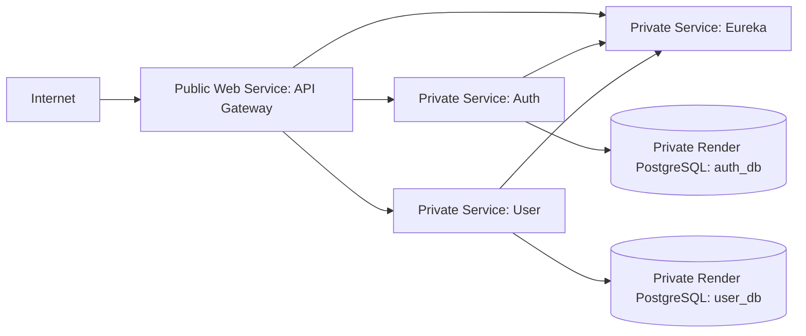

# Deploy the minimal backend to Render

The root [`render.yaml`](../../render.yaml) defines the Render version of the
minimal deployment. It includes only the API Gateway, Eureka, Auth, User, and
two PostgreSQL databases. It does not alter the VPS Compose deployment or
deploy the other backend services, frontend, AI service, Kafka, MongoDB, or
Redis.

## Architecture



All application services and databases are configured for Singapore. Render's
private network is scoped to a workspace and region. Only the Gateway is a
public Web Service; the remaining Spring services are Private Services and both
databases have an empty IP allow list. Eureka and the application ports are not
published as public endpoints. Render provides the public Web Service ingress,
so this deployment does not require a separate reverse proxy.

The Gateway uses `PORT` when Render supplies it and falls back to port `8080`
for the existing Compose deployment. Auth and User retain ports `8081` and
`8082`; Eureka retains port `8761`. Spring Eureka instance hostnames are set to
the services' Render internal hostnames so registrations resolve inside the
private network.

## Prerequisites

- A Render account with access to the GitHub repository
  `veejvn/smart-agri-system`.
- A Render workspace with capacity for four paid Spring services and two
  PostgreSQL databases. The Blueprint selects `0.5c-512mb` for each app and
  `0.1c-256mb` plus 1 GB storage for each database. Check current pricing in the
  Render dashboard before creating resources.
- A frontend origin to configure for CORS. This repository's frontend is not
  deployed by this Blueprint.

The smallest Render free Postgres plan is not suitable for a persistent
production database: Render documents a 30-day expiration for free databases.
The Blueprint explicitly chooses the smallest paid Postgres compute plan.

## Secrets and configuration

The Blueprint wires the application settings already consumed by the source:

| Variable | Set by | Purpose |
| --- | --- | --- |
| `EUREKA_HOST` | Render internal service reference | Eureka internal hostname. |
| `EUREKA_USER` | Entered for discovery on first Blueprint creation, then referenced by clients | Eureka Basic Auth username. |
| `EUREKA_PASSWORD` | Entered for discovery on first Blueprint creation, then referenced by clients | Eureka Basic Auth password. |
| `APP_JWT_SECRET` | Generated by Render for Auth, then referenced by Gateway | Shared Base64 HMAC signing and validation key. |
| `CORS_ALLOWED_ORIGINS` | Entered for the Gateway on first Blueprint creation | Exact frontend origin(s), comma-separated. |
| `DB_HOST`, `DB_PORT`, `DB_USER`, `DB_PASSWORD` | Render Postgres references | Auth and User database connection properties. |
| `PORT` | Render Web Service runtime | Gateway listening port; the application defaults to `8080` outside Render. |

The Auth application and Gateway must keep the same `APP_JWT_SECRET`. Render
generates a Base64-encoded 256-bit value for Auth; the Gateway receives that
same value through a service reference. Do not replace it in only one service.

The Eureka clients interpolate credentials into an HTTP registry URL. For the
initial Blueprint prompts, generate URL-safe hexadecimal values so characters
such as `@`, `:`, `/`, `+`, or `=` cannot break the URL:

```sh
openssl rand -hex 12
openssl rand -hex 32
```

Enter the first value for `EUREKA_USER` and the second for `EUREKA_PASSWORD`.
Enter the exact public frontend origin (for example, `https://app.example.com`)
for `CORS_ALLOWED_ORIGINS`; do not use `*` with credentials enabled.

Render prompts for values marked `sync: false` only when the Blueprint is first
created. If you add these keys later or change them, set them manually in the
Render Dashboard and ensure the referenced services redeploy. Render-managed
environment variables are not baked into Docker image layers.

## Create and deploy the Blueprint

1. Push `render.yaml` and this documentation to the repository's `main` branch.
2. In the Render Dashboard, create a new Blueprint and connect
   `veejvn/smart-agri-system`.
3. Review the six app/database resources and the selected plans and region.
4. Provide the three prompted values: `EUREKA_USER`, `EUREKA_PASSWORD`, and
   `CORS_ALLOWED_ORIGINS`. Render creates the Auth JWT key automatically.
5. Confirm the Blueprint. Render builds each service from its existing
   service-specific Dockerfile and starts the resources.
6. Wait for the Gateway Web Service deployment to pass its HTTP readiness
   check at `/actuator/health/readiness`. Private Services receive Render's TCP
   health check on their listening port; their application-level readiness is
   also available through the private network at `/actuator/health/readiness`.
7. Copy the Gateway's `onrender.com` URL from its Dashboard and exercise the
   Auth and User routes through it.

For subsequent Git pushes, the Blueprint services track `main` and use the
default automatic deploy behavior. Observe build/deploy logs in each Render
service. A change to a private service can take longer to become usable because
Render health checks for Private Services are TCP checks, while the Spring
readiness URL is not configured as a platform HTTP check for those services.

## Validate locally

Render provides a CLI validation command. Install and authenticate the Render
CLI, then run from the repository root:

```sh
render blueprints validate render.yaml
```

The VPS Compose configuration remains independent; use the commands in
[`deploy/compose/README.md`](../compose/README.md) when validating or operating
that deployment. Render secrets should be entered in the Render Dashboard and
never copied into the tracked `.env.example` file.

## Health checks, logs, and troubleshooting

- Gateway: inspect its Render Events and Logs pages; Render calls
  `/actuator/health/readiness` before routing traffic.
- Private services: use their Render Logs and Events pages. A successful TCP
  health check proves the port accepts connections, not that DB/Eureka
  dependencies are ready. Check `/actuator/health/readiness` from another
  service in the same region when diagnosing dependency problems.
- Gateway cannot resolve services: confirm all resources are in the same
  workspace and Singapore region and that Auth/User registered in Eureka with
  their internal Render hostnames.
- Database connection errors: confirm the database is available, its IP allow
  list remains private, and the `DB_*` properties are connected to the matching
  database in the Blueprint.
- Gateway CORS errors: set `CORS_ALLOWED_ORIGINS` to the browser origin exactly,
  including scheme and any non-default port.
- Eureka authentication errors: confirm the user/password values exist on the
  discovery service and were not manually changed on only one client.
- JWT validation errors: ensure Auth and Gateway still receive the same
  generated `APP_JWT_SECRET`.

Render starts and replaces services independently; it does not provide the
Compose `depends_on` startup order. Eureka clients retry registry communication,
but first deployment or a simultaneous restart can temporarily leave services
unregistered. Deploy/inspect Eureka first if the initial service registration
does not recover.

## Rollback and data safety

Use the Render Dashboard's service deploy history to redeploy a prior app
version. Roll back the Gateway and matching application service versions as a
compatible set. Do not delete either PostgreSQL resource as part of an app
rollback. Render Postgres backups and retention are managed separately; create
and verify database backups before schema changes.

Auth and User currently use Hibernate `ddl-auto: update`. This project has no
managed migration workflow yet. Before relying on automated rollback across
database schema changes, introduce backward-compatible expand/migrate/contract
migrations and verify both old and new application versions against the
intermediate schema.

## Scope and limitations

- Render deployment is separate from `deploy/compose/compose.prod.yml` and the
  VPS SSH/GHCR release workflow.
- The Crop, Weather, Forum, Notification, AI, and frontend services plus Kafka,
  MongoDB, and Redis remain outside this milestone.
- Only the Gateway is public. Add a custom domain in Render if desired; Render
  handles public HTTPS ingress for the Web Service.
- This Blueprint does not configure custom-domain DNS, frontend hosting,
  monitoring alerts, scheduled backups, or database migration automation.
- Four continuously running Spring services and two paid databases incur Render
  charges. Confirm current plans and prices before creating the Blueprint.
